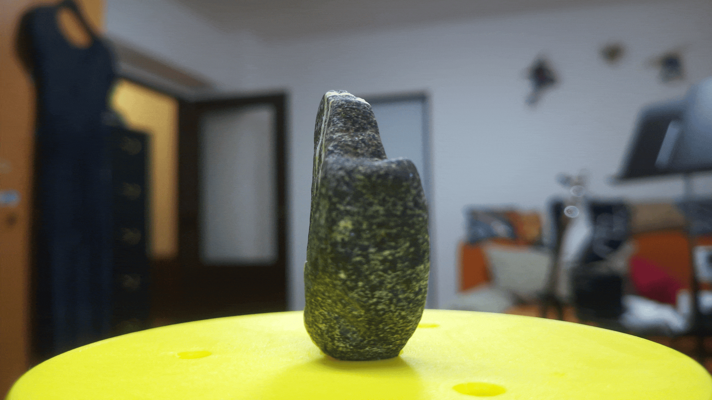

# 3D Photogrammetry Scanner

A custom-built automated 3D photogrammetry scanning system powered by Python, Flask, stepper motors, and a Raspberry Pi. Designed for precise multi-angle object capture and 3D model reconstruction.

## Showcase

### 3D Model Result
[View 3D Model Interactively (GLB)](https://gltf-viewer.donmccurdy.com/#url=https://github.com/c4nt-c0de/3d_scanner/raw/main/showcase_results/rock_test.glb)
*(Click the link above to rotate, inspect, and view the textured 3D scan in your browser)*

## Hardware Stack
- **Microcontroller / Compute:** Raspberry Pi
- **Camera:** Raspberry Pi Camera v3 (for high-resolution image capture)
- **Stepper Motor:** NEMA 17 stepper motor for precise rotational positioning
- **Motor Driver:** BIGTREETECH TMC2209 driver for quiet and smooth microstepping control

## Software Stack
- **Control & Automation:** Python, Flask (web interface for triggering and managing scans)
- **Reconstruction:** Processed and reconstructed using photogrammetry software (e.g., Epic Games RealityScan)

## Features
- Automated rotation and image capture workflow.
- Clean web-based interface for remote triggering.
- Structured output directory management for raw capture data ready for photogrammetry pipelines.
